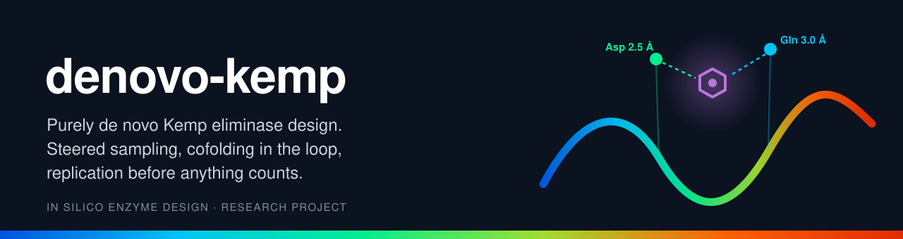
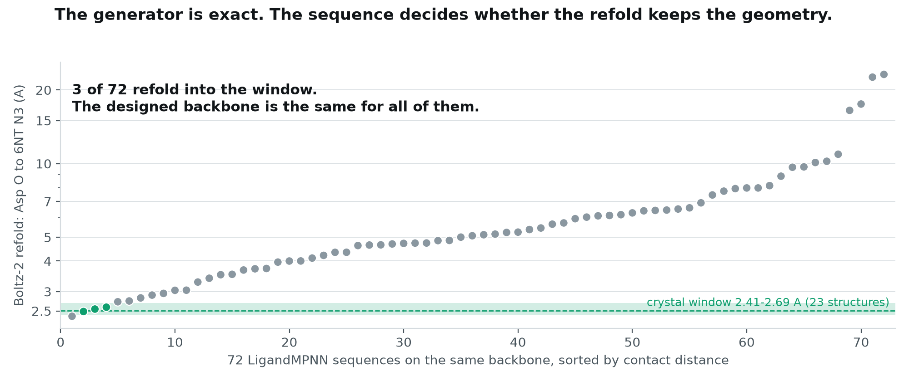
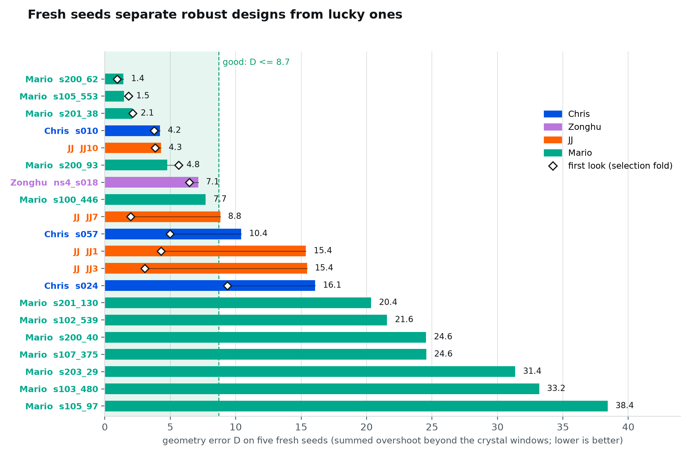

<p align="center">
  
</p>

<p align="center">
  <a href="https://github.com/chr13b/kemp-challenge/actions/workflows/check.yml"></a>
  
  
  
  
</p>

<p align="center">
  <b>We designed Kemp eliminase enzymes from scratch over one weekend, and built the measurements to tell a real design from a lucky fold.</b><br>
  Team 01 at the <i>Perlin × D-BSSE Protein Design Hackathon</i>, 21–22 November 2026.
</p>

---

## The idea in one minute

A **Kemp eliminase** is an enzyme for a reaction that no natural enzyme performs. To work, a carboxylate (Asp) and a hydrogen-bond donor (Gln) must hold the substrate analogue **6NT** in a geometry precise to a few tenths of an ångström. The organizers fold each submitted sequence with **Boltz-2** next to 6NT, five times, and score that geometry. Up to 20 sequences may be submitted, and they must be novel (backbone TM-score ≤ 0.7, sequence identity ≤ 70 %).

We found that the hard part is not generating the geometry. It is keeping it.

> [!IMPORTANT]
> **RFdiffusion3 reproduces the catalytic motif to 0.013 Å in every run. All of the loss happens when Boltz-2 refolds the sequence, and a single refold is noisier (0.4–1 Å per contact) than the 0.28 Å window we aim for.** So we stopped re-rolling the expensive step, sampled sequences in bulk, and let *replication on fresh random seeds* decide what counts.

<p align="center">
  
</p>

### At a glance

| | |
|---|---|
| **0.013 Å** | how closely RFdiffusion3 reproduces the catalytic motif, in all six end-to-end runs |
| **2.41–2.69 Å** | the base-contact window we measured ourselves, across 23 crystal structures (43 ligand copies) |
| **84 %** | of 352 swept designs lose the ligand from the pocket when refolded once |
| **3 / 72** | sequences on one backbone that refold into the window. The pipeline's own single pick falls outside it |
| **11 vs 1** | good designs when LigandMPNN is biased toward a proven parent, against the unbiased baseline (single fold, p = 0.013) |
| **48 → 1** | designs replicated over five seeds → designs passing the selection rule we wrote *before* seeing the data |
| **8 of 20** | designs re-folded on seeds nobody selected on that stayed good, from four different contributors |
| **−0.97** | Spearman correlation between our geometry score and a teammate's independently built scorer, on 44 shared structures |

---

## How it works


| Stage | What we did | Why |
|---|---|---|
| **1. Measure the target** | Full-text PDB search → 97 Kemp eliminase entries → 23 with 6NT bound. Measured every ligand copy. | The brief says "ideal geometry" without numbers. Every engaged catalytic base sits in a **0.28 Å** window. |
| **2. Read the pipeline's own output twice** | Compared the contacts on the *designed* backbone with the *refolded* structure. | Nobody had put the two columns side by side. The generator was exact. The refold, decided by the sequence, was not. |
| **3. Split the pipeline** | Design a backbone once, then sample sequences by the dozen. | RFD3 costs 12 min, LigandMPNN 6 s, Boltz-2 19 s. We were spending the expensive step to re-roll the cheap one. |
| **4. Skip the no-op** | The MSA stage returns depth 1 for de novo sequences. Output is bit-identical without it. | Removed ~45 % of runtime and the 30 GB node requirement (`chris-03`). |
| **5. Bias toward a parent** | LigandMPNN bias file pulling 88 % of positions toward a replicated parent. | Enriched the good tail **11-fold** over unbiased sampling (`wiki/approach.md` §5). |
| **6. Replicate, with a rule written first** | Five Boltz-2 seeds per survivor. Selection rule fixed before the replication data existed. | A single fold ranks noise. 48 designs went through; most single-fold winners did not survive. |
| **7. Fresh seeds** | Re-folded the shortlist on five seeds nobody had selected on. | Winner's curse: the best of many noisy scores is partly luck. |

Details, filters and every number's source: [`wiki/approach.md`](wiki/approach.md).

---

## Results: one instrument for everyone's designs

Late in the hackathon, teammates JJ (10 designs) and Mario (20 designs) sent candidates from their own pipelines. We verified that all 30 meet the submission rules (organizer validator: accepted, structures match sequences 30 of 30, identity ≤ 0.43 to anything else in the pool), folded them on **our** instrument next to ours and Zonghu's, and measured them with the **same code**. Then we folded the shortlist again on five seeds nobody had selected on.

<p align="center">
  
</p>

**Reading the figure.** Bars are the honest number (fresh seeds). Diamonds are what the selection fold said. The gap is the winner's curse, made visible.

| Rank | Source | Design | D (first look) | **D (fresh seeds)** | Zonghu K1–K5 |
|:--:|---|---|:--:|:--:|:--:|
| 1 | Mario | `s200_62` | 0.9 | **1.4** | 0.831 |
| 2 | Mario | `s105_553` | 1.8 | **1.5** | 0.842 |
| 3 | Mario | `s201_38` | 2.1 | **2.1** | 0.739 |
| 4 | Chris | `s010` | 3.8 | **4.2** | 0.575 |
| 5 | JJ | `JJ10` | 3.8 | **4.3** | 0.548 |
| 6 | Mario | `s200_93` | 5.6 | **4.8** | 0.674 |
| 7 | Zonghu | `ns4_s018` | 6.5 | **7.1** | 0.597 |
| 8 | Mario | `s100_446` | n/a | **7.7** | 0.442 |

*D is the summed overshoot beyond the crystal windows in tolerance units (0.25 Å, 15°); lower is better. "Good" is D ≤ 8.7, the 95th percentile of the unbiased baseline. K1–K5 is Zonghu's weighted scorer, run unmodified on the same structures.*

What we take from it:

- **Robust designs exist, from several routes.** Mario's top three hold up on fresh seeds and are the most consistent in the pool. Every design source (Mario, Chris, JJ and Zonghu) has at least one design in the good set.
- **Single-fold scores overstate.** JJ's `JJ1`, `JJ3` and `JJ7` looked excellent on the first look, and each has a fresh seed with D above 33. Our own `s057` and `s024` also regressed.
- **No design passed our strict both-contacts-in-window rule on fresh seeds.** The 8-design file is chosen on fresh mean D, and the wiki says so.
- **Two scorers agree.** Our D and Zonghu's K1–K5 were built independently and rank single folds at Spearman −0.97.

Full tables with every design, its source, seeds and novelty: [`wiki/ranking-combined.md`](wiki/ranking-combined.md). Machine-readable: [`results/ranking_combined_all_seeds.tsv`](results/ranking_combined_all_seeds.tsv).

---

## Three routes, one team

The team ran three independent design strategies, so the comparison is on measured outcomes and not on opinion. The combined pitch deck is in [`slides/three-routes/`](slides/three-routes/).

| Route | Idea | Owner |
|---|---|---|
| **1. Theoretical** | One site taken from the literature. Fix only what does the chemistry (Asp, Gln, Trp, ligand: 27 atoms from a crystal). RFD4-Proteina with gates fixed in code. | Janis (JJ) |
| **2. Evolutionary** (this README) | One backbone, many sequences, biased toward a proven parent, then five-seed replication under a rule written in advance. | Chris |
| **3. Combinatorial** | Build the site from four residues taken from different crystal structures. A cheap OpenFold3 refold gates what is worth a Boltz-2 run. | Mario |

Supporting tooling, each reused by the others:

| | |
|---|---|
| **Scorer v2 and design filters** (Zonghu) | Weighted K1–K5 scorer calibrated on 7K4U, design-funnel filters, novelty gate, rank-stability analysis over 198 five-seed designs. See [`wiki/scoring.md`](wiki/scoring.md), [`wiki/design-filters.md`](wiki/design-filters.md), [`wiki/novelty.md`](wiki/novelty.md). |
| **Target geometry and pitch decks** (Flavia) | Theozyme target geometry measured from PDB 7K4Z, [`src/kemp/geometry.py`](src/kemp/geometry.py), the three HTML pitch decks. |
| **Pipeline, replication, ranking** (Chris) | The cluster pipeline, the unattended Slurm driver, the replication and ranking code, the repo conventions. |

---

## What did not work (and why we kept it in the repo)

Negative results are recorded with the same care as positive ones, because each changed a decision.

| Finding | Evidence | What it changed |
|---|---|---|
| A third anchor (Trp44) **costs designability** | median CA RMSD 2.02 Å vs 0.77 Å, 0 of 72 in window (`chris-05`) | kept the minimal motif |
| Designability is **per backbone** | seed 5: 0 of 48 sequences refolded under 2 Å, and rescue refuted (`chris-07`) | screen backbones by sweeping, not by one try |
| Boltz-2's affinity head **cannot rank enzymes** | HG3 and HG3.17 both score 2.06 despite ~1000× activity (`zonghu-02`) | used as a filter, never a ranker |
| Confidence metrics are **blind to chemistry** | one design had ipTM 0.869 with the ligand 26 Å away | always measure the contact distances directly |
| A rigid Trp indole **destroys the donor contact**; a free Trp brings it back | `zonghu-03` | informed the theozyme route |
| **Polar-down** biasing does nothing | Mann-Whitney p = 0.21 against the unbiased baseline | reported as a null, not hidden |
| The default sampling temperature is the **worst** one | 0/24 in window at T = 0.1 vs 2/24 at T = 0.2 | one flag, free |

---

## Limits, stated plainly

- **Proxy scores, not the organizers' score.** D, D2 and the replicate statistics are our stand-ins. Their functional forms are not public. An independent scorer agrees with ours on ranking, which supports the proxy but does not replace the real thing.
- **One fold for our own designs.** Every Chris-route candidate sits on one backbone, and four of the top five share 88–94 % identity.
- **An angle definition we could not confirm.** Measured *at the heteroatom*, our top designs lie outside the crystal range. Under our own definition they are close. The organizers do not say which they use.
- **Novelty is structural only.** Foldseek TM-score against the Kemp family and 40,066 PDB representatives. We did not run a UniRef identity search for the 70 % rule.
- **No lab or organizer results in this repository.** The final 20-design file was uploaded by a teammate on 2026-11-22 at 12:16 UTC.

Open questions for the organizers (deadline, OD2 versus nearest oxygen, how a team's designs are aggregated) are in [`wiki/challenge.md`](wiki/challenge.md).

---

## How the repository is built

This repo is also a worked example of keeping science honest under time pressure.

- **Pre-registration.** Selection rules were committed before the data they were applied to. Amendments are marked as amendments.
- **Never report a number you did not read from a run.** Every result links to a run directory, a `results/` table or a cluster job.
- **Three layers**, after Karpathy's "LLM Wiki": `raw/` (immutable sources) → `wiki/` + `log/` (distilled, cross-linked knowledge: 13 experiment pages, 40 log entries) → code and artifacts (`src/`, `scripts/`, `cluster/` → `runs/` → `results/`).
- **Run provenance.** Every execution records its config, commit, diff, environment and seed.
- **Guard rails.** Pre-commit hooks (ruff, large files, keys, merge markers, an index linter), CI on every push, and 80 tests including a cross-check against the organizers' own validator.
- **An unattended Slurm driver** (`cluster/autopilot.py`) that replicates, runs arms and ranks while the team sleeps, and a byte-verified upload read-back.
- **Merge-safe teamwork.** Per-person branches, per-person experiment IDs, union-merged index files. 111 commits from three branches merged into one history, with designs and tooling from five people.
- **AI-assisted, with rules.** [`CLAUDE.md`](CLAUDE.md) and [`AGENTS.md`](AGENTS.md) encode the project's discipline (1-based index checks, novelty gate first, no invented numbers) for any assistant.

<details>
<summary><b>Repository map</b></summary>

| Path | What it is |
|---|---|
| [`wiki/`](wiki/) | Knowledge layer: [`approach.md`](wiki/approach.md) (technical description), [`challenge.md`](wiki/challenge.md) (rules and scoring), [`primer.md`](wiki/primer.md) (the project from scratch), [`ranking-combined.md`](wiki/ranking-combined.md), [`experiments/`](wiki/experiments/) |
| [`cluster/`](cluster/) | The GPU pipeline: backbone design, oversampling, five-seed replication, measurement, ranking, assembly of the submission file |
| [`scripts/`](scripts/) | Numbered analysis scripts (`3x` analyze, `9x` submit). `35_plot_readme_figures.py` redraws the figures above |
| [`src/kemp/`](src/kemp/) | Shared library: paths, config, run provenance, submission rules, geometry, scoring, filters |
| [`results/`](results/) | Curated, reproducible outputs: geometry target, sweeps, replication tables, rankings, candidate FASTA files |
| [`slides/`](slides/) | Source of the three pitch decks (HTML on a fixed canvas) |
| [`raw/`](raw/) | The organizers' documents, never edited |
| [`log/`](log/) | One file per log entry, timestamped |
| [`tests/`](tests/) | pytest suite |
| [`INDEX.md`](INDEX.md) | One line per file in the repository |

</details>

---

## Run it

Needs [git](https://git-scm.com/downloads) and [uv](https://docs.astral.sh/uv/getting-started/installation/) (uv brings its own Python).

```bash
git clone https://github.com/chr13b/kemp-challenge.git
cd kemp-challenge
make setup     # environment from uv.lock, plus git hooks
make check     # lint, index lint, 80 tests
uv run python scripts/35_plot_readme_figures.py   # redraw the figures from the tracked tables
```

The analysis and ranking code runs on a laptop from the tracked tables in `results/`. The GPU stages in `cluster/` need a Slurm cluster with RFdiffusion3, LigandMPNN and Boltz-2; the hackathon cluster setup is described in [`wiki/cluster.md`](wiki/cluster.md). Submission format and the validator: [`wiki/submission.md`](wiki/submission.md).

New contributor? [`SETUP.md`](SETUP.md) takes you from zero to running. Branching rules: [`CONTRIBUTING.md`](CONTRIBUTING.md).

## Team

**Chris** ([@chr13b](https://github.com/chr13b)) · **Zonghu** ([@zonghu3112](https://github.com/zonghu3112)) · **Flavia** ([@flavinzgi](https://github.com/flavinzgi)) · **Janis (JJ)** · **Mario**

Thanks to the organizers at Perlin and D-BSSE (ETH Zürich) for the challenge, the cluster and the validator. Built on [RFdiffusion3](https://pubmed.ncbi.nlm.nih.gov/41000976/), [LigandMPNN](https://www.biorxiv.org/content/10.1101/2023.12.22.573103), [Boltz-2](https://github.com/jwohlwend/boltz), [Foldseek](https://github.com/steineggerlab/foldseek) and the Kemp eliminase crystal structures in the PDB (HG3.17 with 6NT is 4BS0).

Released under the [MIT License](LICENSE).
