<p align="center">
  
</p>

<p align="center">
  <a href="https://github.com/chr13b/kemp-challenge/actions/workflows/check.yml"></a>
  
  
  
  
</p>

<p align="center">
  <b>Purely de novo Kemp eliminase design: a high-throughput pipeline that generates thousands of candidates,<br>
  and the measurements that tell a real design from a lucky fold.</b><br>
  Team 01 at the <i>Perlin × D-BSSE Protein Design Hackathon</i>, 21–22 November 2026.
</p>

---

## The idea in one minute

A **Kemp eliminase** is an enzyme for a reaction that no natural enzyme performs. To work, a carboxylate (Asp) and a hydrogen-bond donor (Gln) must hold the substrate analogue **6NT** in a geometry precise to a few tenths of an ångström. The organizers fold each submitted sequence with **Boltz-2** next to 6NT, five times, and score that geometry. Up to 20 sequences may be submitted, and they must be novel (backbone TM-score ≤ 0.7, sequence identity ≤ 70 %).

We found that the hard part is not generating the geometry. It is keeping it.

> [!IMPORTANT]
> **RFdiffusion3 reproduces the catalytic motif to 0.013 Å in every run. All of the loss happens when Boltz-2 refolds the sequence, and a single refold is noisier (0.4–1 Å per contact) than the 0.28 Å window we aim for.** So we stopped re-rolling the expensive step, sampled sequences in bulk, steered the sampler toward what worked, and let *replication on fresh random seeds* decide what counts.

<p align="center">
  
</p>

### At a glance

| | |
|---|---|
| **> 14,000** | designs generated or scored across the team's three design routes, filtered down to 20 submissions |
| **0.013 Å** | how closely RFdiffusion3 reproduces the catalytic motif, in all six end-to-end runs |
| **2.41–2.69 Å** | the base-contact window we measured ourselves, across 23 crystal structures (43 ligand copies) |
| **TM ≤ 0.61** | structural novelty of the 8 best designs against the PDB (gate: 0.70). Aligned sequence identity 2–5 % |
| **84 %** | of 352 swept designs lose the ligand from the pocket when refolded once |
| **11 vs 1** | good designs when LigandMPNN is steered toward a proven parent, against the unbiased baseline (single fold, p = 0.013) |
| **8 of 20** | designs re-folded on seeds nobody selected on that stayed good, across all three approaches |
| **−0.97** | Spearman correlation between our geometry score and an independently built scorer, on 44 shared structures |

---

## A purely de novo design

Every design in this repository is generated from scratch. Only the coordinates of a few catalytic side chains and the ligand come from crystal structures. The backbone comes from a generative model and the sequence is designed on top of it, with no natural protein as a template. All eight designs below sit under the 0.70 novelty gate against every known structure we checked.

<p align="center">
  
</p>

| ID | Approach | Residues | TM-score to Kemp family | TM-score to PDB | Aligned identity |
|---|---|:--:|:--:|:--:|:--:|
| C-s200_62 | Combinatorial | 166 | 0.39 | 0.60 | 3 % |
| C-s105_553 | Combinatorial | 219 | 0.37 | 0.49 | 5 % |
| C-s201_38 | Combinatorial | 229 | 0.38 | 0.51 | 3 % |
| E-s010 | Evolutionary | 260 | 0.30 | 0.57 | 3 % |
| T-10 | Theoretical | 171 | 0.36 | 0.61 | 2 % |
| C-s200_93 | Combinatorial | 239 | 0.36 | 0.50 | 4 % |
| E-ns4_s018 | Evolutionary | 260 | 0.30 | 0.55 | 3 % |
| C-s100_446 | Combinatorial | 237 | 0.39 | 0.47 | 3 % |

*TM-scores are Foldseek TM-align, normalised by the designed protein, against the Kemp eliminase family and 40,066 PDB representatives (novelty gate: 0.70). Aligned identity is the sequence identity inside the alignment to the closest hit. An MMseqs2 search found no homologue at all. The IDs carry the approach letter (T, E, C) used throughout.*

> [!NOTE]
> **From screen to bench.** The hackathon closes the loop in the lab: every team could nominate at least five designs for experimental validation, independent of score, and our designs are being tested in the wet lab for ligand binding.

---

## How it works

```mermaid
flowchart LR
    A["<b>Motif</b><br/>Asp + Gln + 6NT<br/>measured on 23 crystals"] --> B["<b>RFdiffusion3</b><br/>260-residue backbone<br/>~12 min"]
    B --> C["<b>LigandMPNN</b><br/>steered sampling<br/>Asp and Gln pinned"]
    C --> D["<b>Boltz-2 cofold</b><br/>one fold screens<br/>~19 s each"]
    D --> E["<b>Replicate</b><br/>5 seeds, then fresh<br/>seeds for the survivors"]
    E --> F["<b>Gates</b><br/>novelty · index check<br/>organizer validator"]
    F --> G(["<b>designs.fasta</b><br/>at most 20"])
    classDef step fill:#0B1220,stroke:#0151E2,color:#fff,stroke-width:2px;
    classDef out fill:#01A98C,stroke:#01A98C,color:#fff;
    class A,B,C,D,E,F step;
    class G out;
```



| Stage | What we did | Why |
|---|---|---|
| **1. Measure the target** | Full-text PDB search → 97 Kemp eliminase entries → 23 with 6NT bound. Measured every ligand copy. | The brief says "ideal geometry" without numbers. Every engaged catalytic base sits in a **0.28 Å** window. |
| **2. Read the pipeline's own output twice** | Compared the contacts on the *designed* backbone with the *refolded* structure. | Nobody had put the two columns side by side. The generator was exact. The refold, decided by the sequence, was not. |
| **3. Split the pipeline** | Design a backbone once, then sample sequences by the dozen. | RFD3 costs 12 min, LigandMPNN 6 s, Boltz-2 19 s. We were spending the expensive step to re-roll the cheap one. |
| **4. Skip the no-op** | The MSA stage returns depth 1 for de novo sequences. Output is bit-identical without it. | Removed ~45 % of runtime and the 30 GB node requirement ([evidence](wiki/experiments/chris-03_msa-free-boltz-screen.md)). |
| **5. Steer the sampler** | A per-residue bias on LigandMPNN's logits (next section). | Enriched the good tail **11-fold** over unbiased sampling. |
| **6. Replicate, with a rule written first** | Five Boltz-2 seeds per survivor. Selection rule fixed before the replication data existed. | A single fold ranks noise. 48 designs went through; most single-fold winners did not survive. |
| **7. Fresh seeds** | Re-folded the shortlist on five seeds nobody had selected on. | Winner's curse: the best of many noisy scores is partly luck. |

### A high-throughput funnel

At about 19 s per Boltz-2 fold and 6 s per LigandMPNN batch, one GPU screens roughly **190 designs per hour** once the MSA stage is dropped. An unattended Slurm driver (`cluster/autopilot.py`) ran the replicate, sample and rank loop without supervision. Each route ended in the same measurement.

| Route | Designs generated or scored | Where it is recorded |
|---|---|---|
| Evolutionary (one backbone, many sequences) | **568** sequences folded and measured (352 in sweeps, 216 in three steering arms), plus 48 replicated over five seeds | [`wiki/approach.md`](wiki/approach.md), [`results/`](results/) |
| Theoretical (site from the literature) | **2,554** designs scored, 10 forwarded | [`slides/three-routes/`](slides/three-routes/) |
| Combinatorial (site from many structures) | **about 11,000** designs over four campaigns | [`slides/three-routes/`](slides/three-routes/) |

The filters, in the order applied: single-fold geometry (removes the 84 % that lose the ligand), confidence filters (iPDE < 1.6, ipTM > 0.85), five-seed replication, a selection rule, the novelty gate, an index check of every `base=` and `oxy=` residue, and the organizers' own validator.

---

## The math behind the two levers

### 1. What we minimise: the geometry error D

The scored quantities are two catalytic contacts (Asp O → N3 and Gln N → N1 of 6NT) and, for each, an approach angle and an in-plane angle. We measured each term across the engaged crystal copies, which gives a window $[\ell_t, u_t]$, and count how far a refolded design lies outside it, in tolerance units:

$$
o_t \;=\; \frac{w_t\,(\ell_t - x_t)_{+} \;+\; (x_t - u_t)_{+}}{\tau_t},
\qquad
D \;=\; \sum_{t=1}^{6} o_t,
\qquad
\bar D \;=\; \frac{1}{5}\sum_{s=1}^{5} D^{(s)}
$$

with $(z)_+ = \max(z, 0)$, tolerance $\tau_t = 0.25$ Å for distances and $15^\circ$ for angles, and weight $w_t = 2$ for a distance that is too short (it is punished harder than too long), otherwise $w_t = 1$. A design is **good** when $\bar D \le 8.7$, the 95th percentile of the unbiased baseline population. Because the organizers state that the worse of angle and in-plane decides per contact, we also report $D_2$, which replaces each contact's pair of angle terms by their maximum.

<details>
<summary>The six crystal windows</summary>

| Term | Window | Tolerance |
|---|---|---|
| base distance (Asp O → N3) | 2.41–2.69 Å | 0.25 Å |
| donor distance (Gln N → N1) | 2.92–3.24 Å | 0.25 Å |
| base approach angle | 167.1–175.8° | 15° |
| base in-plane angle | 1.0–11.7° | 15° |
| donor approach angle | 162.1–173.0° | 15° |
| donor in-plane angle | 0.6–16.1° | 15° |

From the engaged ligand copies of the Kemp eliminase entries in the PDB (`results/kemp_family_geometry.tsv`). The code is `cluster/rescore_replicated.py`.

</details>

### 2. How we steer LigandMPNN

LigandMPNN decodes a sequence one position at a time, conditioned on the backbone, the ligand and the residues already chosen. At position $i$ it computes logits $z_i(a)$ over the 20 amino acids and samples from

$$
p_i(a) \;=\; \frac{\exp\!\big((z_i(a) + b_i(a))\,/\,T\big)}{\sum_{a'} \exp\!\big((z_i(a') + b_i(a'))\,/\,T\big)}
$$

where $T$ is the sampling temperature and $b_i(a)$ is a per-position, per-residue bias that we supply. The bias is added before the division, so it multiplies the odds of two residues by $\exp(\Delta b / T)$. At $T = 0.3$, a bias of $+1.5$ is a factor of $e^{5} \approx 148$. That is why the biases are small numbers and still decisive. The two catalytic residues are held out of the sampling entirely (`--fixed_residues`), so Asp86 and Gln52 survive in every sequence.

| Steering arm | Bias $b_i(a)$ | Effect we measured |
|---|---|---|
| **Close variants of a proven parent** | $+1.5$ toward the parent's residue at a random 88 % of free positions | identity to the parent 63 % → 91 %. Good designs **11 vs 1** (p = 0.013) |
| **Polar-down** | $-1.5$ on S, T, N, Q, H at the 11 free pocket positions | polar count 4.0 → 1.7 of 11, but no gain in geometry (p = 0.21): a real null |

Both biases were applied as intended, which we verified on the sequences that came out. At the five-seed level the enrichment is weaker than at the single-fold level, and we report that too. Details: [`wiki/approach.md`](wiki/approach.md) §5.

---

## Results: one instrument for every design

Late in the hackathon, candidate sets from the other two routes (10 and 20 designs) arrived. We verified that all 30 meet the submission rules (organizer validator: accepted; structures match sequences 30 of 30; identity ≤ 0.43 to anything else in the pool), folded them on **our** instrument next to the evolutionary designs, and measured them with the **same code**. Then we folded the shortlist again on five seeds nobody had selected on.

<p align="center">
  
</p>

**Reading the figure.** Bars are the honest number (fresh seeds). Diamonds are what the selection fold said. The gap is the winner's curse, made visible.

| Rank | Approach | ID | D (first look) | **D (fresh seeds)** | K1–K5 (independent scorer) |
|:--:|---|---|:--:|:--:|:--:|
| 1 | Combinatorial | C-s200_62 | 0.9 | **1.4** | 0.831 |
| 2 | Combinatorial | C-s105_553 | 1.8 | **1.5** | 0.842 |
| 3 | Combinatorial | C-s201_38 | 2.1 | **2.1** | 0.739 |
| 4 | Evolutionary | E-s010 | 3.8 | **4.2** | 0.575 |
| 5 | Theoretical | T-10 | 3.8 | **4.3** | 0.548 |
| 6 | Combinatorial | C-s200_93 | 5.6 | **4.8** | 0.674 |
| 7 | Evolutionary | E-ns4_s018 | 6.5 | **7.1** | 0.597 |
| 8 | Combinatorial | C-s100_446 | n/a | **7.7** | 0.442 |

*D is the geometry error from the equation above; lower is better. K1–K5 is a weighted five-criteria scorer that was built independently and run unmodified on the same structures.*

What we take from it:

- **Robust designs exist, from all three approaches.** The top three are the most consistent designs in the pool, and the independent scorer ranks them first as well.
- **Single-fold scores overstate.** Three theoretical designs (T-1, T-3, T-7) looked excellent on the first look, and each has a fresh seed with D above 33. Two evolutionary designs (E-s057, E-s024) also regressed.
- **No design passed our strict both-contacts-in-window rule on fresh seeds.** The 8-design set is chosen on fresh mean D, and the wiki says so.
- **Two scorers agree.** Our D and the independent K1–K5 were built separately and rank single folds at Spearman −0.97.
- **The evolutionary route also led the wider ranking.** In the independent scorer's five-seed ranking of 193 designs, E-ns4_s018 came first and E-s010 second. That ranking uses the selection seeds, before the fresh-seed re-fold above.

Full tables with every design, its approach, seeds and novelty: [`wiki/ranking-combined.md`](wiki/ranking-combined.md). Machine-readable: [`results/ranking_combined_all_seeds.tsv`](results/ranking_combined_all_seeds.tsv).

---

## Three routes, one team

We ran three independent design strategies, so the comparison rests on measured outcomes and not on opinion. The combined pitch deck is in [`slides/three-routes/`](slides/three-routes/).

| Route | Idea |
|---|---|
| **1. Theoretical** (T) | One site taken from the literature. Fix only what does the chemistry (Asp, Gln, Trp, ligand: 27 atoms from a crystal). RFD4-Proteina with gates fixed in code. |
| **2. Evolutionary** (E) | One backbone, many sequences, steered toward a proven parent, then five-seed replication under a rule written in advance. |
| **3. Combinatorial** (C) | Build the site from four residues taken from different crystal structures. A cheap OpenFold3 refold gates what is worth a Boltz-2 run. |

Shared tooling built along the way, used by all three: a weighted five-criteria **scorer** calibrated on crystal geometry ([`wiki/scoring.md`](wiki/scoring.md)); **design-funnel filters** ([`wiki/design-filters.md`](wiki/design-filters.md)); the **novelty gate** ([`wiki/novelty.md`](wiki/novelty.md)); a **geometry module** ([`src/kemp/geometry.py`](src/kemp/geometry.py)); the **replication and ranking code** in [`cluster/`](cluster/); and the three **pitch decks** in [`slides/`](slides/).

---

## What did not work (and why we kept it in the repo)

Negative results are recorded with the same care as positive ones, because each changed a decision.

| Finding | Evidence | What it changed |
|---|---|---|
| A third anchor (Trp44) **costs designability** | median CA RMSD 2.02 Å vs 0.77 Å, 0 of 72 in window ([evidence](wiki/experiments/chris-05_trp44-three-anchor-retested.md)) | kept the minimal motif |
| Designability is **per backbone** | seed 5: 0 of 48 sequences refolded under 2 Å, and rescue refuted ([evidence](wiki/experiments/chris-07_rescue-written-off-backbones.md)) | screen backbones by sweeping, not by one try |
| Boltz-2's affinity head **cannot rank enzymes** | HG3 and HG3.17 both score 2.06 despite ~1000× activity ([evidence](wiki/experiments/zonghu-02_affinity-ladder-controls.md)) | used as a filter, never a ranker |
| Confidence metrics are **blind to chemistry** | one design had ipTM 0.869 with the ligand 26 Å away | always measure the contact distances directly |
| A rigid Trp indole **destroys the donor contact**; a free Trp brings it back | [evidence](wiki/experiments/zonghu-03_trp-flexibility-and-dyad-geometry.md) | informed the theozyme route |
| **Polar-down** steering does nothing | Mann-Whitney p = 0.21 against the unbiased baseline | reported as a null, not hidden |
| The default sampling temperature is the **worst** one | 0/24 in window at T = 0.1 vs 2/24 at T = 0.2 | one flag, free |

---

## Toolbox and skills

### Tools we ran

| Area | Tools |
|---|---|
| **Generative design** | RFdiffusion3 (backbones around a fixed motif), RFD4-Proteina, LigandMPNN (sequence design with ligand context and per-residue bias) |
| **Structure prediction** | Boltz-2 cofolding with ligand 6NT (200 sampling steps, 3 recycling steps), OpenFold3 as a cheap gate |
| **Novelty and search** | Foldseek TM-align against the Kemp family and 40,066 PDB representatives, MMseqs2 |
| **Analysis** | Python, NumPy, Biotite (structure geometry), stdlib-only scripts on the cluster head node, PyMOL (renders), matplotlib |
| **Compute** | Slurm on AWS GPU nodes (L4), conda environments, an unattended time-aware driver, S3 upload with byte-verified read-back |
| **Statistics** | Mann-Whitney U, Fisher's exact test, Spearman rank correlation, winner's-curse control with held-out seeds |
| **Engineering** | uv, pytest (80 tests), ruff, pre-commit, GitHub Actions, Makefile, per-run provenance (config, commit, diff, seed) |
| **Communication** | A cross-linked Markdown wiki, a timestamped log, and three HTML pitch decks |

### Skills this project exercised

- **Protein design and structural bioinformatics.** Catalytic-geometry measurement from crystals, theozyme construction, backbone designability, novelty analysis.
- **Experimental discipline.** Pre-registered selection rules, controls that calibrate the instrument, held-out seeds, and negative results kept on the record.
- **Quantitative judgement.** Turning an under-specified scoring brief into measurable proxies, then checking them against an independently built scorer.
- **High-throughput computing.** Splitting a pipeline by cost, removing a stage that measurement showed to be a no-op, and automating the cluster so it runs unattended.
- **Software quality.** Tested, linted, reproducible code with a map of every file, and an off-by-one guard on the 1-based residue indices that the scorer would otherwise silently misread.
- **Teamwork.** Three parallel routes, one shared evaluation, merge-safe branches and a single history.

---

## Limits, stated plainly

- **Proxy scores, not the organizers' score.** D, $D_2$ and the replicate statistics are our stand-ins. The organizers' functional forms are not public, and per-design scores were not released to the team. An independent scorer agrees with ours on ranking, which supports the proxy but does not replace the real thing.
- **One fold for the evolutionary designs.** Every candidate of that route sits on one backbone, and four of the top five share 88–94 % identity.
- **An angle definition we could not confirm.** Measured *at the heteroatom*, our top designs lie outside the crystal range. Under our own definition they are close. The organizers do not say which they use.
- **Novelty is structural.** TM-score against the Kemp family and the PDB. We did not run a UniRef identity search for the 70 % rule.
- **Wet-lab results are not in this repository.**

The final 20-design file was uploaded on 2026-11-22. Open questions we put to the organizers (OD2 versus nearest oxygen, how a team's designs are aggregated) are in [`wiki/challenge.md`](wiki/challenge.md).

---

## How the repository is built

This repo is also a worked example of keeping science honest under time pressure.

- **Pre-registration.** Selection rules were committed before the data they were applied to. Amendments are marked as amendments.
- **Never report a number you did not read from a run.** Every result links to a run directory, a `results/` table or a cluster job.
- **Three layers**, after Karpathy's "LLM Wiki": `raw/` (immutable sources) → `wiki/` + `log/` (distilled, cross-linked knowledge: 13 experiment pages, over 40 log entries) → code and artifacts (`src/`, `scripts/`, `cluster/` → `runs/` → `results/`).
- **Run provenance.** Every execution records its config, commit, diff, environment and seed.
- **Guard rails.** Pre-commit hooks (ruff, large files, keys, merge markers, an index linter), CI on every push, and an 80-test suite including a cross-check against the organizers' own validator.
- **An unattended Slurm driver** (`cluster/autopilot.py`) that replicates, runs arms and ranks while the team sleeps, and a byte-verified upload read-back.
- **Merge-safe teamwork.** Per-person branches, per-person experiment IDs, union-merged index files: over 110 commits from three branches merged into one history, with designs and tooling from five people.
- **AI-assisted, with rules.** [`CLAUDE.md`](CLAUDE.md) and [`AGENTS.md`](AGENTS.md) encode the project's discipline (1-based index checks, novelty gate first, no invented numbers) for any assistant.

<details>
<summary><b>Repository map</b></summary>

| Path | What it is |
|---|---|
| [`wiki/`](wiki/) | Knowledge layer: [`approach.md`](wiki/approach.md) (technical description), [`challenge.md`](wiki/challenge.md) (rules and scoring), [`primer.md`](wiki/primer.md) (the project from scratch), [`ranking-combined.md`](wiki/ranking-combined.md), [`experiments/`](wiki/experiments/) |
| [`cluster/`](cluster/) | The GPU pipeline: backbone design, oversampling, five-seed replication, measurement, ranking, assembly of the submission file |
| [`scripts/`](scripts/) | Numbered analysis scripts (`3x` analyze, `9x` submit). `35_plot_readme_figures.py` redraws the figures above |
| [`src/kemp/`](src/kemp/) | Shared library: paths, config, run provenance, submission rules, geometry, scoring, filters |
| [`results/`](results/) | Curated, reproducible outputs: geometry target, sweeps, replication tables, rankings, candidate FASTA files |
| [`slides/`](slides/) | Source of the three pitch decks (HTML on a fixed canvas) |
| [`tools/`](tools/) | Small utilities, including the PyMOL render script behind the design figure |
| [`raw/`](raw/) | The organizers' documents, never edited |
| [`log/`](log/) | One file per log entry, timestamped |
| [`tests/`](tests/) | pytest suite |
| [`INDEX.md`](INDEX.md) | One line per file in the repository |

</details>

---

## Run it

Needs [git](https://git-scm.com/downloads) and [uv](https://docs.astral.sh/uv/getting-started/installation/) (uv brings its own Python).

```bash
git clone https://github.com/chr13b/kemp-challenge.git
cd kemp-challenge
make setup     # environment from uv.lock, plus git hooks
make check     # lint, index lint, tests
uv run python scripts/35_plot_readme_figures.py   # redraw the figures from the tracked tables
```

The analysis and ranking code runs on a laptop from the tracked tables in `results/`. The GPU stages in `cluster/` need a Slurm cluster with RFdiffusion3, LigandMPNN and Boltz-2; the hackathon cluster setup is described in [`wiki/cluster.md`](wiki/cluster.md). Submission format and the validator: [`wiki/submission.md`](wiki/submission.md).

New contributor? [`SETUP.md`](SETUP.md) takes you from zero to running. Branching rules: [`CONTRIBUTING.md`](CONTRIBUTING.md).

## Team 01

Built by a five-person team that ran three design routes in parallel and one shared evaluation. It was a group project from the first sweep to the last figure.

Thanks to the organizers at Perlin and D-BSSE (ETH Zürich) for the challenge, the cluster and the validator. Built on [RFdiffusion3](https://pubmed.ncbi.nlm.nih.gov/41000976/), [LigandMPNN](https://www.biorxiv.org/content/10.1101/2023.12.22.573103), [Boltz-2](https://github.com/jwohlwend/boltz), [Foldseek](https://github.com/steineggerlab/foldseek) and the Kemp eliminase crystal structures in the PDB (HG3.17 with 6NT is 4BS0).

Released under the [MIT License](LICENSE).
